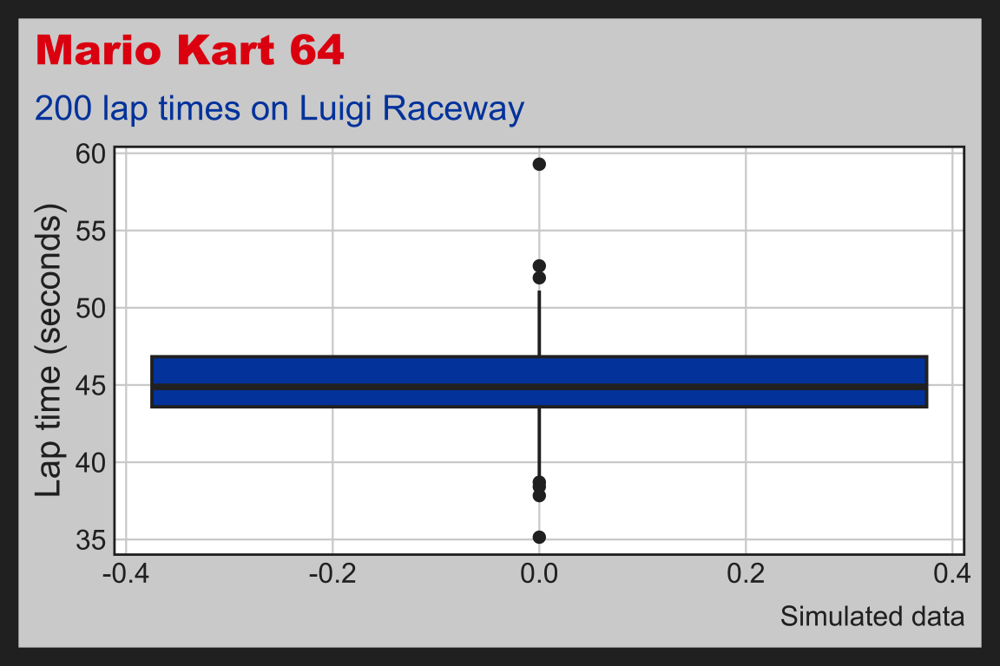
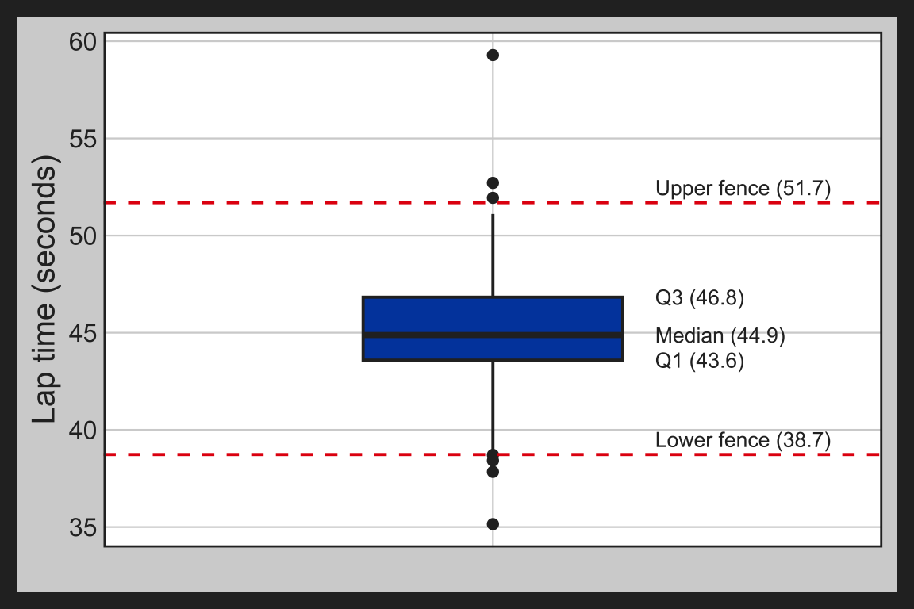
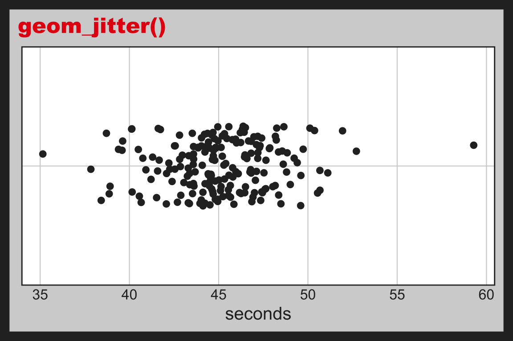
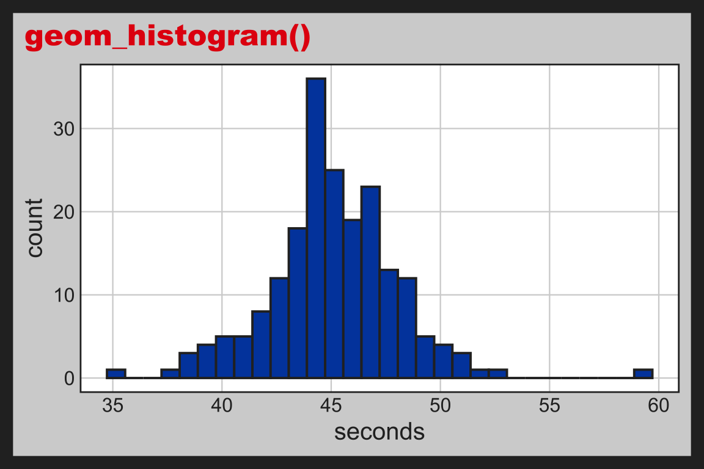
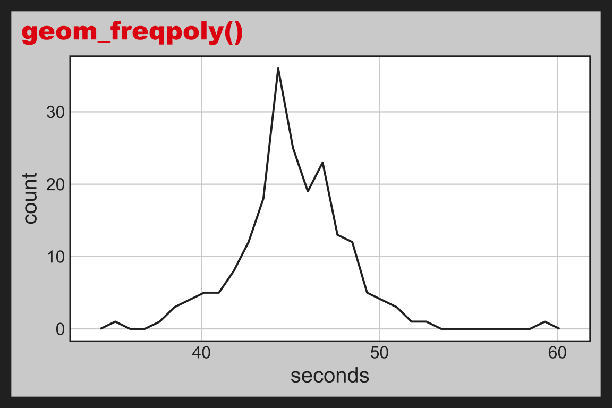
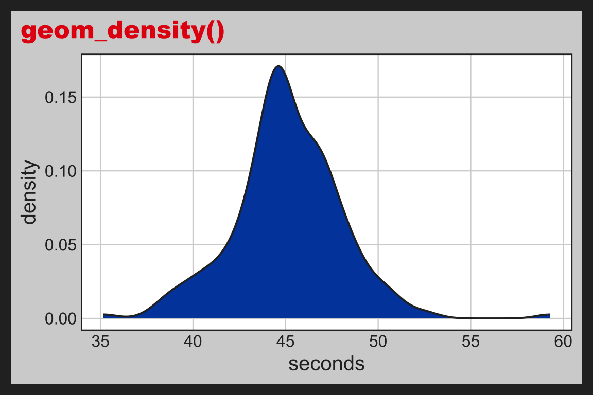
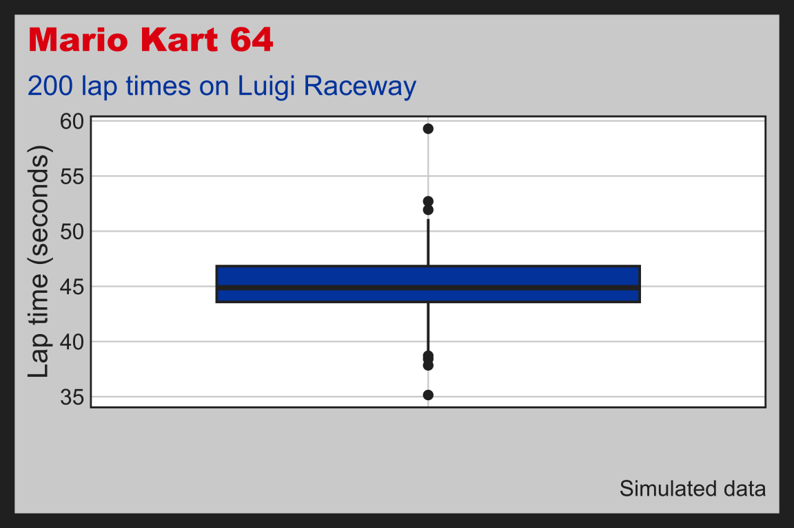

# Box plots {#sec-box-plots}


::: {.callout-tip collapse="true" appearance="simple"}
## Theme: `theme_n64()`

Graphs in this chapter use `fmggp2::theme_n64()`, modeled on the Nintendo 64: controller gray background, charcoal frame, the red, green, blue, and yellow logo colors, and an Arial Black title.
:::

:::: {.callout-note collapse="false" icon=false}

::: {style="font-size: 1.10em; color: #02577A;"}
**Requirements:**
:::

::: {style="font-size: 1.05em; color: #282b2d;"}
**✅ a numeric (continuous) variable**
:::

<br>


::: {.cell layout-align="right"}
::: {.cell-output-display}
{fig-align='right' width=60% height=60%}
:::
:::


::::

## Description

Box plots use five values to summarize data: minimum, first quartile, median, third quartile, and maximum. The plot looks like a box with a line in the middle. Whiskers go from the box to the smallest and largest values that aren't unusual. Unusual points are shown as dots outside the whiskers. Box plots help identify unusual points and compare different groups of data.

## Set up

::: {style="font-size: 1.10em; color: #1e83c8;"}
**PACKAGES:**
:::

::: {style="font-size: 0.95rem;"}
Install packages.
:::


::: {style="font-size: 0.85em;"}

::: {.cell}

```{.r .cell-code  code-fold="show"}
library(ggplot2)
library(dplyr) # for tibble() and data manipulation
```
:::

:::


::: {style="font-size: 1.10em; color: #1e83c8;"}
**DATA:**
:::

::: {style="font-size: 0.95rem;"}
Most Mario Kart 64 laps on Luigi Raceway take about the same time. Every so often, though, a player nails a mushroom boost (a very fast lap) or gets hit by a blue shell (a very slow one). We'll simulate 200 lap times with `rt()`, which draws from a distribution with more extreme values than the normal. Setting the seed with `set.seed()` means you'll get the same 200 laps every time you run the code below.
:::

::: {style="font-size: 0.85em;"}

::: {.cell}

```{.r .cell-code  code-fold="show"}
set.seed(64) # same 200 laps every time the code runs
mario_kart_laps <- tibble(
  lap_id = 1:200, # 200 different laps, one row each
  seconds = round(
    45 + 2 * rt(n = 200, df = 3), # lap times centered at 45 seconds (heavy tails create outliers)
    2 # two decimal places
    )
)
glimpse(mario_kart_laps)
#> Rows: 200
#> Columns: 2
#> $ lap_id  <int> 1, 2, 3, 4, 5, 6, 7, 8, 9, 10, 1…
#> $ seconds <dbl> 42.88, 47.11, 44.55, 47.41, 38.7…
```
:::

:::

## Distribution

A box plot doesn't draw every value. It draws five summary numbers and then flags the values that are unusually far from the middle. That makes it a good tool for data with extreme values, as long as you know how those five numbers and the outlier rule work. Below we'll move from the lap times, to a picture, to the formula.

::: {style="font-size: 1.10em; color: #1e83c8;"}
**COUNT IT:**
:::

Start with the first ten laps.

::: {style="font-size: 0.85em;"}

::: {.cell}

```{.r .cell-code  code-fold="show"}
head(mario_kart_laps$seconds, 10)
#>  [1] 42.88 47.11 44.55 47.41 38.71 44.51 44.63
#>  [8] 44.23 46.00 48.25
```
:::

:::

Most of these laps take between 42 and 49 seconds, but one (38.71) is much faster than the rest. The numbers behind a box plot are the quartiles: the 25th percentile (Q1), the median, and the 75th percentile (Q3). The distance between Q1 and Q3 is the interquartile range (IQR). Any value more than 1.5 IQRs past Q1 or Q3 (the "fences") is drawn as an outlier.

::: {style="font-size: 0.85em;"}

::: {.cell}

```{.r .cell-code  code-fold="show"}
lap_stats <- mario_kart_laps |> 
  summarise(
    q1 = quantile(seconds, 0.25),
    median = median(seconds),
    q3 = quantile(seconds, 0.75),
    iqr = IQR(seconds),
    lower_fence = q1 - 1.5 * iqr,
    upper_fence = q3 + 1.5 * iqr,
    outliers = sum(seconds < lower_fence | seconds > upper_fence))
lap_stats
```

::: {.cell-output-display}
`````{=html}
<div data-pagedtable="false">
  <script data-pagedtable-source type="application/json">
{"columns":[{"label":["q1"],"name":[1],"type":["dbl"],"align":["right"]},{"label":["median"],"name":[2],"type":["dbl"],"align":["right"]},{"label":["q3"],"name":[3],"type":["dbl"],"align":["right"]},{"label":["iqr"],"name":[4],"type":["dbl"],"align":["right"]},{"label":["lower_fence"],"name":[5],"type":["dbl"],"align":["right"]},{"label":["upper_fence"],"name":[6],"type":["dbl"],"align":["right"]},{"label":["outliers"],"name":[7],"type":["int"],"align":["right"]}],"data":[{"1":"43.59","2":"44.88","3":"46.83","4":"3.24","5":"38.73","6":"51.69","7":"7"}],"options":{"columns":{"min":{},"max":[10]},"rows":{"min":[10],"max":[10]},"pages":{}}}
  </script>
</div>
`````
:::
:::

:::

Half of all laps fall inside a window only 3.2 seconds wide, yet 7 laps land outside the fences. The lap at 38.71 seconds from the first ten is one of them: it's just below the lower fence.

::: {style="font-size: 1.10em; color: #1e83c8;"}
**DRAW IT:**
:::

The box plot below labels each of those numbers. The box runs from Q1 to Q3, and the line inside it is the median. The whiskers stop at the last lap inside the fences, and every lap past a fence is drawn as a point.

::: {style="font-size: 0.85em;"}

::: {.cell}

```{.r .cell-code  code-fold="show"}
box_labels <- tibble(
  y = c(lap_stats$q1, lap_stats$median, lap_stats$q3,
        lap_stats$lower_fence, lap_stats$upper_fence),
  label = c("Q1", "Median", "Q3", "Lower fence", "Upper fence"),
  vjust = c(0.5, 0.5, 0.5, -0.5, -0.5))

ggplot(data = mario_kart_laps, aes(x = "", y = seconds)) + 
  geom_boxplot(width = 0.4) + 
  geom_hline(yintercept = c(lap_stats$lower_fence, lap_stats$upper_fence), 
    linetype = "dashed", color = "#E4000F") + 
  geom_text(data = box_labels, 
    aes(x = 1.25, y = y, vjust = vjust,
        label = paste0(label, " (", round(y, 1), ")")), 
    hjust = 0, size = 3.5) + 
  labs(x = NULL, y = "Lap time (seconds)")
```

::: {.cell-output-display}
{width=100%}
:::
:::

:::

A box plot hides the shape between the five numbers. The plots below show the same 200 laps four other ways. Every one puts most laps near 45 seconds, with a few scattered far out on both sides. The last three also show a single peak.

::: {style="font-size: 0.85em;"}

::: {.cell layout-ncol="2"}

```{.r .cell-code  code-fold="show"}
ggplot(mario_kart_laps, aes(x = seconds, y = "")) + 
  geom_jitter(height = 0.2) + 
  labs(title = "geom_jitter()", y = NULL)

ggplot(mario_kart_laps, aes(x = seconds)) + 
  geom_histogram(bins = 30) + 
  labs(title = "geom_histogram()")

ggplot(mario_kart_laps, aes(x = seconds)) + 
  geom_freqpoly(bins = 30) + 
  labs(title = "geom_freqpoly()")

ggplot(mario_kart_laps, aes(x = seconds)) + 
  geom_density() + 
  labs(title = "geom_density()")
```

::: {.cell-output-display}
{width=100%}
:::

::: {.cell-output-display}
{width=100%}
:::

::: {.cell-output-display}
{width=100%}
:::

::: {.cell-output-display}
{width=100%}
:::
:::

:::

::: {style="font-size: 1.10em; color: #1e83c8;"}
**NAME IT:**
:::

The `rt()` call draws from [Student's t distribution](https://en.wikipedia.org/wiki/Student%27s_t-distribution), which is then stretched and shifted into lap times:

$$
X = 45 + 2T, \quad T \sim t(\nu = 3)
$$

The 45 sets the center (the median lap) and the 2 sets the spread. The degrees of freedom ($\nu$) control the tails. A small $\nu$ like 3 gives "heavy" tails with more extreme values than a normal distribution. As $\nu$ grows, the t distribution turns into the normal.

Steady laps are what we expect, and a normal distribution is the right model for them. The mushroom boosts and blue shells are the unexpected part, and the heavy tails of `df = 3` add them in.

The outlier rule shows the difference. For a normal distribution, only about 0.7% of values land past the fences, so we'd expect about 1 outlier in 200 laps. For a t distribution with 3 degrees of freedom, about 5.5% land past the fences, or about 11 laps in 200. We got 7.

Try `df = 30` in `rt()`. We'd expect only about 2 outliers in 200 laps, but this seed still gives 6. A single sample of 200 laps can land far from what we expect. The code below draws 5,000 laps for each `df` and counts the laps past the fences.

::: {style="font-size: 0.85em;"}

::: {.cell}

```{.r .cell-code  code-fold="show"}
set.seed(64)
tibble(
  df = rep(c(3, 30), each = 5000), # 5,000 laps for each df
  seconds = 45 + 2 * rt(n = 10000, df = df)) |>
  group_by(df) |>
  summarise(
    q1 = quantile(seconds, 0.25),
    q3 = quantile(seconds, 0.75),
    iqr = IQR(seconds),
    outliers = sum(seconds < q1 - 1.5 * iqr | seconds > q3 + 1.5 * iqr),
    percent = round(100 * outliers / n(), 1))
```

::: {.cell-output-display}
`````{=html}
<div data-pagedtable="false">
  <script data-pagedtable-source type="application/json">
{"columns":[{"label":["df"],"name":[1],"type":["dbl"],"align":["right"]},{"label":["q1"],"name":[2],"type":["dbl"],"align":["right"]},{"label":["q3"],"name":[3],"type":["dbl"],"align":["right"]},{"label":["iqr"],"name":[4],"type":["dbl"],"align":["right"]},{"label":["outliers"],"name":[5],"type":["int"],"align":["right"]},{"label":["percent"],"name":[6],"type":["dbl"],"align":["right"]}],"data":[{"1":"3","2":"43.57132","3":"46.57236","4":"3.001039","5":"266","6":"5.3"},{"1":"30","2":"43.62583","3":"46.30174","4":"2.675918","5":"59","6":"1.2"}],"options":{"columns":{"min":{},"max":[10]},"rows":{"min":[10],"max":[10]},"pages":{}}}
  </script>
</div>
`````
:::
:::

:::

With more laps, the drop is clear: 5.3% of the `df = 3` laps are outliers, compared with 1.2% of the `df = 30` laps.

::: {style="font-size: 1.10em; color: #1e83c8;"}
**CHANGE IT:**
:::

The table above counts the outliers, but we can also see them. Below we draw 200 steady laps (`df = 30`, what we expect) next to 200 laps with mushrooms and blue shells (`df = 3`, the unexpected) on one shared axis.

::: {style="font-size: 0.85em;"}

::: {.cell}

```{.r .cell-code  code-fold="show"}
set.seed(64)
mario_kart_compare <- tibble(
  df = rep(c(30, 3), each = 200), # 200 laps for each df
  seconds = round(45 + 2 * rt(n = 400, df = df), 2))

ggplot(data = mario_kart_compare, 
  aes(x = factor(df, levels = c(30, 3), 
                 labels = c("df = 30 (expected)", "df = 3 (unexpected)")), 
      y = seconds)) + 
  geom_boxplot(width = 0.4) + 
  labs(x = NULL, y = "Lap time (seconds)")
```

::: {.cell-output-display}
{width=100%}
:::
:::

:::

The two boxes are about the same size (IQRs of 2.54 and 2.81 seconds), so the middle half of the laps barely changes. The difference is past the whiskers. The steady laps leave 6 points outside the fences, while the unexpected laps leave 14, and one of them is a 20.8 second lap. That matches the 1.2% and 5.3% above: changing only the tails fills a box plot with dots and leaves the box alone.


## Grammar


::: {style="font-size: 1.10em; color: #1e83c8;"}
**CODE:**
:::

::: {style="font-size: 0.95rem;"}

Create labels with `labs()`

  - Assign a blank character string (`""`) to the `x` axis in `labs()`

Initialize the graph with `ggplot()` and provide `data`

Map `seconds` to the `y` axis and an empty string (`""`) to the `x` axis

Add the `geom_boxplot()` layer

:::

::: {style="font-size: 0.85em;"}

::: {.cell}

```{.r .cell-code  code-fold="show"}
labs_boxplot <- labs(
  title = "Mario Kart 64",
  caption = "Simulated data",
  subtitle = "200 lap times on Luigi Raceway",
  x = "",
  y = "Lap time (seconds)")
ggp2_boxplot <- ggplot(data = mario_kart_laps,
           aes(x = "", 
               y = seconds)) +
        geom_boxplot() 
ggp2_boxplot + 
  labs_boxplot
```
:::

:::


::: {style="font-size: 1.10em; color: #1e83c8;"}
**GRAPH:**
:::


::: {.cell layout-nrow="1"}
::: {.cell-output-display}
{width=100%}
:::
:::


