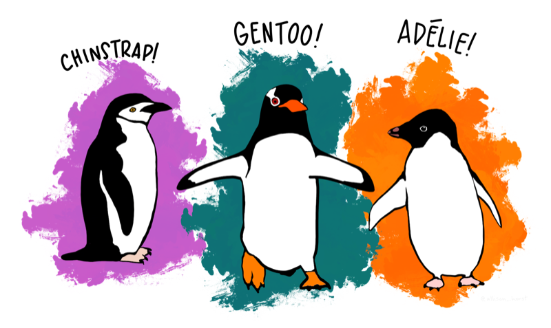

# Directed Acyclic Graphs (DAGs) {.unnumbered}

```{r}
#| label: setup
#| message: false
#| warning: false
#| include: false
library(tidyverse)
library(lubridate)
library(scales)
library(knitr)
library(kableExtra)
library(colorblindr)
library(downlit)
# fonts ----
library(extrafont)
library(sysfonts)
source("_common.R")
# use font
showtext::showtext_auto()
# set theme
ggplot2::theme_set(theme_ggp2g(
    base_size = 15))
```

```{r}
#| label: status
#| results: "asis"
#| echo: false
# status ----
# polish, dev, draft, complete
status("draft")
```


:::: {.callout-note collapse="false" icon=false}
## Graph overview
::: {.fm-req-title}

:::

<br>

```{r}
#| label: full_code_display
#| eval: true
#| echo: false
#| warning: false
#| message: false
#| out-height: '60%'
#| out-width: '60%'
#| fig-align: right
library(palmerpenguins) 
library(ggplot2movies)
library(fivethirtyeight)
library(ggplot2)
df <- tibble::tibble(X = sample(x = 1:100, 10, FALSE),
                     Y = rlnorm(10, 1, 3))
labs_graph <- ggplot2::labs(title = "Title", 
                            subtitle = "subtitle", 
                            x = "X", y = "Y")

ggp2_graph <- ggplot2::ggplot(data = df, 
    mapping = aes(x = X, y = Y)) + 
    ggplot2::geom_blank()

ggp2_graph + 
    labs_graph
```

::: {.fm-req-title}
**Requirements:**
:::

::: {.fm-req}
**✅ a categorical variable**      
:::

::: {.fm-req}
**✅ a numeric (continuous) variable**
:::

::::

## Description 

Description of graph aesthetics, appropriate use, similar graphs, etc. 

## Set up 


### PACKAGES {.unnumbered .fm-label}

::: {.fm-small}
Install packages.
:::


```{r}
#| label: pkg_code_dags
#| eval: true
#| echo: true
#| warning: false
#| message: false
#| results: hide
install.packages("palmerpenguins")
library(palmerpenguins)
library(ggplot2)
```


### DATA {.unnumbered .fm-label}

<!-- 
::: {.column-margin}
{fig-align="right" width="30%" height="30%"}
{fig-align="right" width="15%" height="15%"}
{fig-align="right" width="20%" height="20%"}
:::
-->


::: {.fm-small}
<!-- Description of data -->
:::

```{r}
#| label: data_code_dags
#| eval: true
#| echo: true
df <- tibble::tibble(X = sample(x = 1:100, 10, FALSE),
                     Y = rlnorm(10, 1, 3))
dplyr::glimpse(df)
```
::::

## Grammar


### CODE {.unnumbered .fm-label}

::: {.fm-small}

Create labels with `labs()`

Initialize the graph with `ggplot()` and provide `data`

:::

```{r}
#| label: code_graph_dags
#| eval: false
#| echo: true 
#| warning: false
#| message: false
#| out-height: '100%'
#| out-width: '100%'
#| layout-nrow: 1
labs_graph <- ggplot2::labs(title = "Title", 
                            subtitle = "subtitle", 
                            x = "X", y = "Y")

ggp2_graph <- ggplot2::ggplot(data = df, 
    mapping = aes(x = X, y = Y)) + 
    ggplot2::geom_blank()

ggp2_graph + 
    labs_graph
```


:::: {.column-margin}
::: {.fm-note}
More description of graph and code. 
:::
::::

### GRAPH {.unnumbered .fm-label}

```{r}
#| label: create_graph_dags
#| eval: true
#| echo: false
#| warning: false
#| message: false
#| out-height: '100%'
#| out-width: '100%'
#| layout-nrow: 1
labs_graph <- ggplot2::labs(title = "Title", 
                            subtitle = "subtitle", 
                            x = "X", y = "Y")

ggp2_graph <- ggplot2::ggplot(data = df, 
    mapping = aes(x = X, y = Y)) + 
    ggplot2::geom_blank()

ggp2_graph + 
    labs_graph
```

::::

## More info


### Info

:::: {.column-margin}
::: {.fm-note}
Info 
:::
::::

#### INFO {.unnumbered .fm-label}

::: {.fm-small}

:::

```{r}
#| label: more_info_1_dags
#| code-fold: true
#| eval: true
#| echo: true
#| warning: false
#| message: false
#| out-height: '100%'
#| out-width: '100%'
#| layout-nrow: 1
```

### More 

#### MORE {.unnumbered .fm-label}

::: {.fm-small}

:::

```{r}
#| label: more_info_2_dags
#| code-fold: true
#| eval: true
#| echo: true
#| warning: false
#| message: false
#| out-height: '100%'
#| out-width: '100%'
#| layout-nrow: 1
```

::::
