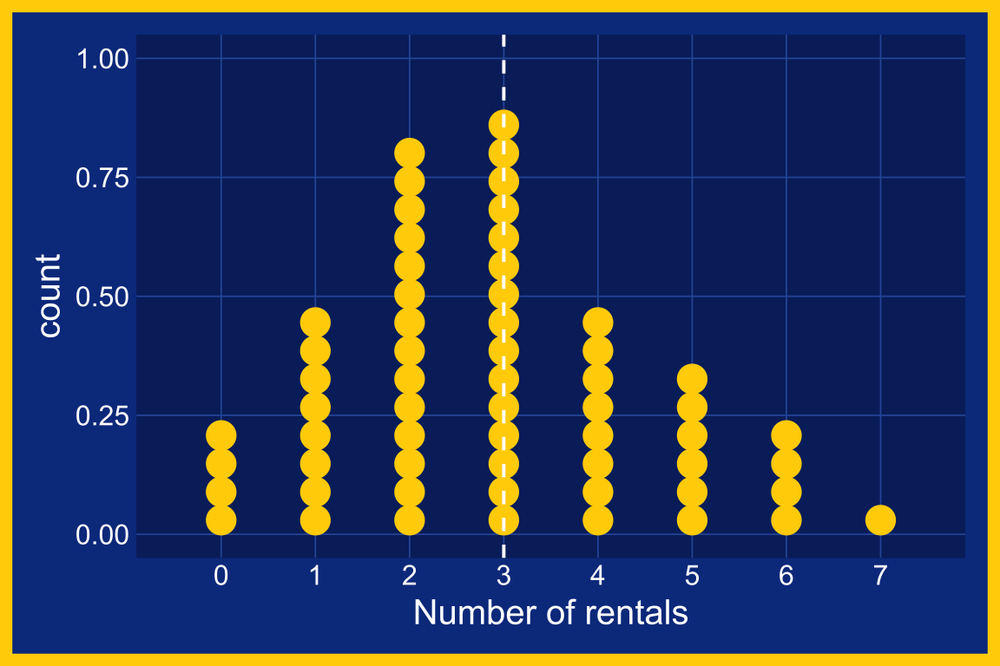
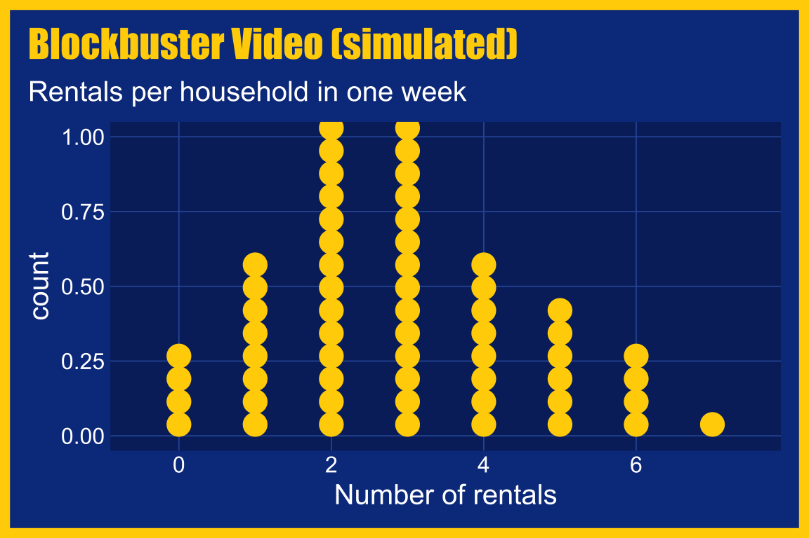

# Dot plots {#sec-dot-plots}


::: {.callout-tip collapse="true" appearance="simple"}
## Theme: `theme_blockbuster()`

Graphs in this chapter use `fmggp2::theme_blockbuster()`, modeled on a Blockbuster Video store: royal blue background, yellow ticket stub marks, white Arial text, and an Impact title.
:::

:::: {.callout-note collapse="false" icon=false}

::: {style="font-size: 1.10em; color: #02577A;"}
**Requirements:**
:::

::: {style="font-size: 1.05em; color: #282b2d;"}
**✅ a numeric (continuous) variable**
:::

<br>


::: {.cell layout-align="right"}
::: {.cell-output-display}
{fig-align='right' width=60% height=60%}
:::
:::


::::

## Description 

A dot plot draws each data point as a dot on a single axis. This makes it useful for spotting patterns, gaps, and outliers in small to moderate datasets. Each dot represents an observation in the data, stacked over categories or spread along a number line.

In `ggplot2`, we can build dot plots with [`geom_dotplot()`](https://ggplot2.tidyverse.org/reference/geom_dotplot.html).

## Set up

::: {style="font-size: 1.10em; color: #1e83c8;"}
**PACKAGES:**
:::


Install packages.


::: {style="font-size: 0.85em;"}

::: {.cell}

```{.r .cell-code  code-fold="show"}
library(ggplot2)
library(dplyr) # for tibble() and data manipulation
```
:::

:::


::: {style="font-size: 1.10em; color: #1e83c8;"}
**DATA:**
:::

In the late 90s, most Friday nights started at [Blockbuster Video](https://en.wikipedia.org/wiki/Blockbuster_(retailer)). 

::: {.column-margin}

{fig-align="center" width="50%" height="50%"}

:::

We'll simulate how many movies 60 households rented in one week with `rpois()`, which generates whole number counts (0, 1, 2, and so on). Setting the seed with `set.seed()` means you'll get the same 60 households every time you run the code below.

::: {style="font-size: 0.85em;"}

::: {.cell}

```{.r .cell-code  code-fold="show"}
set.seed(1993) # same 60 households every time the code runs
blockbuster_rentals <- tibble(
  household_id = 1:60, # 60 different households, one row each
  rentals = rpois(n = 60, lambda = 3) # weekly rentals (about 3 on average)
)
glimpse(blockbuster_rentals)
#> Rows: 60
#> Columns: 2
#> $ household_id <int> 1, 2, 3, 4, 5, 6, 7, 8, 9, …
#> $ rentals      <int> 2, 0, 2, 4, 3, 3, 2, 2, 5, …
```
:::

:::

## Distribution

Rentals are counts: a household rents 0, 1, 2, or more movies, but never 2.5. Dot plots fit counts like these well. Each dot is one household, so the graph is just the data stacked into piles.

{fig-align="center" width="80%" height="80%"}

Because we picked the rental rate in `rpois()`, we know what the piles should look like before we draw them. Below we'll move from the counts, to a picture, to the formula. Then we'll change the data and see what the same graph shows when households don't behave the way we expected.

::: {style="font-size: 1.10em; color: #1e83c8;"}
**COUNT IT:**
:::

Start with the first ten households.

::: {style="font-size: 0.85em;"}

::: {.cell}

```{.r .cell-code  code-fold="show"}
head(blockbuster_rentals$rentals, 10)
#>  [1] 2 0 2 4 3 3 2 2 5 0
```
:::

:::

Most of these households rented two or three movies, two rented none, and one rented five. If we count all 60 households, we can compare each pile to the number of households we'd expect (we'll see where `dpois()` comes from below).

::: {style="font-size: 0.85em;"}

::: {.cell}

```{.r .cell-code  code-fold="show"}
blockbuster_rentals |> 
  count(rentals) |> 
  mutate(expected = round(60 * dpois(rentals, lambda = 3), 1))
```

::: {.cell-output-display}
`````{=html}
<div data-pagedtable="false">
  <script data-pagedtable-source type="application/json">
{"columns":[{"label":["rentals"],"name":[1],"type":["int"],"align":["right"]},{"label":["n"],"name":[2],"type":["int"],"align":["right"]},{"label":["expected"],"name":[3],"type":["dbl"],"align":["right"]}],"data":[{"1":"0","2":"4","3":"3.0"},{"1":"1","2":"8","3":"9.0"},{"1":"2","2":"14","3":"13.4"},{"1":"3","2":"15","3":"13.4"},{"1":"4","2":"8","3":"10.1"},{"1":"5","2":"6","3":"6.0"},{"1":"6","2":"4","3":"3.0"},{"1":"7","2":"1","3":"1.3"}],"options":{"columns":{"min":{},"max":[10]},"rows":{"min":[10],"max":[10]},"pages":{}}}
  </script>
</div>
`````
:::
:::

:::

The observed piles stay close to the expected ones. Counts like these have one more property worth checking: the mean and the variance should be about the same.

::: {style="font-size: 0.85em;"}

::: {.cell}

```{.r .cell-code  code-fold="show"}
blockbuster_rentals |> 
  summarise(mean = mean(rentals), variance = var(rentals))
```

::: {.cell-output-display}
`````{=html}
<div data-pagedtable="false">
  <script data-pagedtable-source type="application/json">
{"columns":[{"label":["mean"],"name":[1],"type":["dbl"],"align":["right"]},{"label":["variance"],"name":[2],"type":["dbl"],"align":["right"]}],"data":[{"1":"2.9","2":"2.80339"}],"options":{"columns":{"min":{},"max":[10]},"rows":{"min":[10],"max":[10]},"pages":{}}}
  </script>
</div>
`````
:::
:::

:::

::: {style="font-size: 1.10em; color: #1e83c8;"}
**DRAW IT:**
:::

The dot plot below stacks one dot per household above its number of rentals. The tallest piles sit at two and three rentals, and the piles get shorter on both sides. The dashed line marks the rental rate we used in `rpois()` (3 per week). The right side trails out further than the left because a household can't rent fewer than zero movies.

::: {style="font-size: 0.85em;"}

::: {.cell}

```{.r .cell-code  code-fold="show"}
ggplot(data = blockbuster_rentals, 
    aes(x = rentals)) + 
  geom_dotplot(binwidth = 1, dotsize = 0.3) + 
  geom_vline(xintercept = 3, linetype = "dashed", color = "white") + 
  scale_x_continuous(breaks = 0:7) + 
  labs(x = "Number of rentals")
```

::: {.cell-output-display}
{width=100%}
:::
:::

:::

::: {style="font-size: 1.10em; color: #1e83c8;"}
**NAME IT:**
:::

The `rpois()` call that created the data is a single statement: 

$$
X \sim \text{Poisson}(\lambda = 3)
$$

The [Poisson distribution](https://en.wikipedia.org/wiki/Poisson_distribution) describes counts of events in a fixed window of time (here, rentals in one week). It has a single parameter, the rate ($\lambda$), which is both the mean and the variance. That's why our simulated mean (2.9) and variance (2.8) are so close. 

The chance of a household renting exactly $k$ movies is:

$$
P(X = k) = \frac{\lambda^k e^{-\lambda}}{k!}
$$

This is what `dpois()` calculates. For $k = 3$, $P(X = 3) = 3^3 e^{-3} / 3! \approx 0.224$, so we'd expect about $60 \times 0.224 \approx 13$ of our 60 households to rent three movies. We got 15. Try a larger `lambda` in `rpois()` and the piles move right and spread out, because the mean and the variance grow together.

::: {style="font-size: 1.10em; color: #1e83c8;"}
**CHANGE IT:**
:::

The Poisson piles above are what we expected. Real stores rarely behave this way: some households never came in, and a few rented a stack of new releases every Friday. Below we'll keep the average near three rentals but let households differ, using `rnbinom()` (a [negative binomial](https://en.wikipedia.org/wiki/Negative_binomial_distribution) count). We should see more zeros, a longer right tail, and a variance much larger than the mean.

::: {style="font-size: 0.85em;"}

::: {.cell}

```{.r .cell-code  code-fold="show"}
set.seed(1993) # same seed as above
blockbuster_bingers <- tibble(
  household_id = 1:60,
  rentals = rnbinom(n = 60, mu = 3, size = 1) # about 3 on average, households differ
)
blockbuster_bingers |>
  summarise(mean = mean(rentals), variance = var(rentals))
```

::: {.cell-output-display}
`````{=html}
<div data-pagedtable="false">
  <script data-pagedtable-source type="application/json">
{"columns":[{"label":["mean"],"name":[1],"type":["dbl"],"align":["right"]},{"label":["variance"],"name":[2],"type":["dbl"],"align":["right"]}],"data":[{"1":"2.65","2":"10.02797"}],"options":{"columns":{"min":{},"max":[10]},"rows":{"min":[10],"max":[10]},"pages":{}}}
  </script>
</div>
`````
:::
:::

:::

The mean dropped a little, to 2.65, but the variance jumped to 10.03. We'll redraw the same dot plot with the same dashed line at three rentals.

::: {style="font-size: 0.85em;"}

::: {.cell}

```{.r .cell-code  code-fold="show"}
ggplot(data = blockbuster_bingers,
    aes(x = rentals)) +
  geom_dotplot(binwidth = 1, dotsize = 0.3) +
  geom_vline(xintercept = 3, linetype = "dashed", color = "white") +
  scale_x_continuous(breaks = 0:13) +
  labs(x = "Number of rentals")
```

::: {.cell-output-display}
{width=100%}
:::
:::

:::

The dashed line no longer sits near the tallest pile. The tallest pile is now at zero: 17 households rented nothing, where the Poisson model expects about 3. Half of the 60 households rented zero or one movie, and the piles at two and three shrank. On the right, 7 households rented seven or more (the Poisson model expects about 2), and two rented 13.

Because every dot is one household, the graph shows what the average alone would hide: households with very different rental habits, many renting little and a few renting a lot. I've found this is the first thing to check with count data. If the variance is much bigger than the mean, a single Poisson rate isn't telling the whole story.


## Grammar

::: {style="font-size: 1.10em; color: #1e83c8;"}
**CODE:**
:::

1. Create labels with `labs()`

2. Initialize the graph with `ggplot()` and provide `data`

3. Map `rentals` to the `x` axis

4. Add the `geom_dotplot()` layer

5. Set the `binwidth` to `1` (one pile per number of rentals) and adjust the `dotsize`

6. Set the `x` axis breaks with `scale_x_continuous(breaks = 0:7)`

::: {style="font-size: 0.85em;"}

::: {.cell}

```{.r .cell-code  code-fold="show"}
labs_dotplot <- labs(
  title = "Blockbuster Video",
  caption = "Simulated data",
  subtitle = "Rentals per household in one week",
  x = "Number of rentals")
ggp2_dotplot <- ggplot(data = blockbuster_rentals,
      aes(x = rentals)) + 
    geom_dotplot(binwidth = 1, dotsize = 0.2) + 
    scale_x_continuous(breaks = 0:7) 
ggp2_dotplot + 
  labs_dotplot
```
:::

:::


::: {style="font-size: 1.10em; color: #1e83c8;"}
**GRAPH:**
:::


::: {.cell layout-nrow="1"}
::: {.cell-output-display}
{width=100%}
:::
:::


A downside of dot plots is that the `y` axis is hard to interpret.[^dot-y-axis] The axis is labeled `count`, but its numbers run from 0 to 1, even though the tallest pile in our graph holds 15 households.

These numbers don't line up with the piles because `geom_dotplot()` doesn't put counts on the `y` axis. It sizes each dot as a fraction of the `binwidth` (with `dotsize = 0.2`, each dot is a fifth of one rental wide). Then it stacks the dots on top of each other until the pile runs out. The height of a pile depends on how many dots it holds *and* how big each dot is. Changing `dotsize` makes every pile taller or shorter without changing the data. The `y` axis isn't measuring anything; it's just leftover space for the dots to sit in.

The number of households is still in the graph. We read it by counting the dots in each pile, not by looking across to the axis. Because the axis can mislead readers, it's common to hide it with `scale_y_continuous(NULL, breaks = NULL)`.


::: {.cell layout-nrow="1"}

```{.r .cell-code}
labs_dotplot <- labs(
  title = "Blockbuster Video",
  caption = "Simulated data",
  subtitle = "Rentals per household in one week",
  x = "Number of rentals")
ggp2_dotplot <- ggplot(data = blockbuster_rentals,
      aes(x = rentals)) + 
    geom_dotplot(binwidth = 1, dotsize = 0.2) + 
    scale_x_continuous(breaks = 0:7) + 
    scale_y_continuous(NULL, breaks = NULL)
ggp2_dotplot + 
  labs_dotplot
```

::: {.cell-output-display}
{width=100%}
:::
:::


[^dot-y-axis]: Read more in the [function reference.](https://ggplot2.tidyverse.org/reference/geom_dotplot.html#details) 


