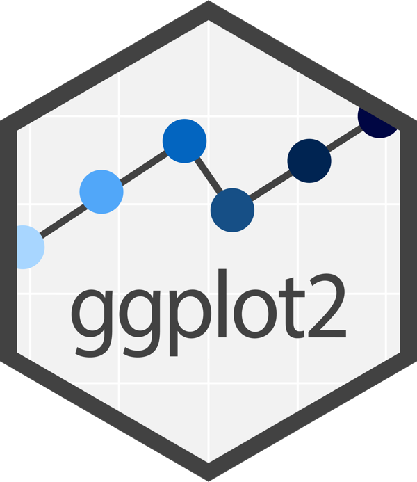
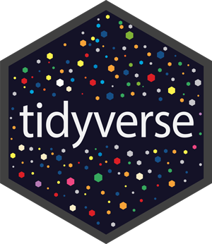

# Welcome! {.unnumbered}

```{r}
#| label: setup
#| message: false
#| warning: false
#| include: false
library(tidyverse)
library(scales)
library(knitr)
library(kableExtra)
# _common.R ----
source("_common.R")
# use font
showtext::showtext_auto()
# set theme
ggplot2::theme_set(theme_ggp2g(
    base_size = 15))
```

Welcome to the `ggplot2` field manual! 

I created this book as a sort of online 'quick reference' to help me answer questions like:[^tidytuesday-callout]  

  - "*What graph should I use?*"  
  
  - "*What kind of graph is that?*"

  - "*Can (or should) I build that graph?*"

[^tidytuesday-callout]: *Most of these questions come from [#TidyTuesday](https://github.com/rfordatascience/tidytuesday)*

## What's new in this edition

Previous versions of this book used datasets from data packages, and a single, consistent plot theme. I've rebuilt the examples in this manual around simulated data, and each section has its own theme. 

### Why simulated data? 

Earlier versions borrowed datasets from packages like `palmerpenguins`, `fivethirtyeight`, and `ggplot2movies`. Those are great example datasets, but each one meant another package to install, and the shape of the data was whatever the real world handed us. 

I've built many data visualizations since writing the first edition of this book, and found myself asking questions like, "*What **should** this graph be showing?* Or *what if the data were collected under slightly different conditions?*?

Simulating the data gave me control over the distribution and structure, something I couldn't do with real datasets. Building the distributions also forced me to think about each graph differently before I started drawing it. I highly recommend reviewing the code I used in each chapter to create the data. It’s usually only a few lines of code; most of it uses base R (like `rnorm()`, `rpois()`, and `sample()`) or a handful of user-written packages (like [`faux`](https://debruine.github.io/faux/)).

The simulated data connects the numbers to the picture in a new **Distribution** section, so you’ll see why a histogram is shaped like a bell and why a box plot shows so many outliers, not just how to build it.

```{r}
#| label: co_box_dev
#| echo: false
#| results: asis
#| eval: true
co_box(
  color = "r", look = "default", hsize = "1.15", size = "1.05", fold = FALSE,
  header = "Who actually wrote this",
  contents = "Given the landscape of LLMs and AI slop, I now feel it’s important to clarify the authorship of anything I write. It seems strange to include this note, but if I were reading a book/blog post/article, I’d want to know.

I used LLMs (only Claude from Anthropic) to research specific distribution topics and help write code to generate the simulated data. I’d typically write a ‘first draft’ of a code example, then ask Claude how to improve it. Sometimes I agreed with the suggestions (and included them). Other times I revised the code myself.

I wrote all of the narrative, description, and code explanations, so the thoughts in the book are my own. Hopefully, the typos and/or grammatical errors serve as a signature of authenticity."
)
```


I also wanted the examples to be fun to read, so every dataset is a late 90s throwback. You'll find Talkboy messages, Blockbuster rentals, Pokémon starters, and Mario Kart 64 lap times, and each one is drawn with a matching theme (Windows 98, the original Game Boy, the Nintendo 64, and more). The themes live in the [`fmggp2`](https://mjfrigaard.github.io/fmggp2/) package, which also holds the helpers used throughout the book.

```{mermaid}
%%| fig-align: 'center'
%%| fig-cap: 'How each chapter builds its example'
%%{init: {'theme': 'base', 'themeVariables': { 'fontFamily': 'monospace', 'fontSize': '14px', 'darkMode': false}}}%%

flowchart TB
    dist(["<strong>Distribution</strong><br>normal, Poisson,<br>gamma, ..."]) -->|"i. set.seed()"| sim["<strong>Simulate</strong><br>base R or <code>faux</code>"]
    sim --> dset[("<strong>90s dataset</strong><br>OK Soda, Pogs,<br>Happy Meals, ...")]
    dset -->|"ii. Distribution section"| connect["<strong>Connect</strong><br>count it, draw it,<br>name it"]
    connect -->|"iii. Grammar section"| gg[["<strong>ggplot2 graph</strong><br><code>fmggp2::theme_*()</code>"]]

    style dist fill:#4CBB9D,color:#FFFFFF,rx:5,ry:5
    style sim fill:#FFFFFF,color:#000000,stroke:#333
    style dset fill:#C0C0C0,color:#000000,stroke:#333
    style connect fill:#FFFFFF,color:#000000,stroke:#333
    style gg fill:#000080,color:#FFFFFF,rx:5,ry:5
```

## Getting started

-   Option 1: install `ggplot2` using the code below:

    ```{r}
    #| label: ggp2-pkg
    #| eval: false
    #| echo: true
    #| code-fold: false
    install.packages("ggplot2")
    library(ggplot2)
    ```

::: {.column-margin}
{fig-align="center" width="40%" height="40%"}
:::


-   Option 2 (recommended): `ggplot2` is also part of the `tidyverse` 

    ```{r}
    #| label: tidyverse-pkg
    #| eval: false
    #| echo: true
    #| code-fold: false
    install.packages("tidyverse")
    library(tidyverse)
    ```

::: {.column-margin}
{fig-align="center" width="40%" height="40%"}
:::


-   Install `fmggp2` to use the 90s themes from the book:

    ```{r}
    #| label: fmggp2-pkg
    #| eval: false
    #| echo: true
    #| code-fold: false
    install.packages("pak")
    pak::pak("mjfrigaard/fmggp2")
    library(fmggp2)
    ```

## Who this book was written for

I created this resource with the following [learner personas](https://teachtogether.tech/en/index.html#s:process-personas) in mind:

1. **Garth** is a data analyst putting together a slide deck for an upcoming meeting. He had a few statistics courses with R in college, and has picked up additional experience and skills from the different positions he's held and various online tutorials. He's currently building the graphs in his slides with `ggplot2`, but had grown tired of them and would like to customize his presentation to make it more engaging. 

2. **Matilda** is a data journalist hoping to add a few graphs to a piece she has been working on. She has 10 years of experience working with WordPress, writes and publishes on her own blog, and has an intermediate understanding of HTML & CSS. However, she has only been programming in R for about 6 months.

3. **Igor** is a researcher who has been working in academia for 15 years. He's comfortable writing R code, knows the kinds of graphs he'd like to build, but he only knows how to build these using the [base R graphics](https://bookdown.org/rdpeng/exdata/the-base-plotting-system-1.html). He'd like to learn how to duplicate the graphs he's already created in base R using `ggplot2`.

## Where to learn more 

Because this is intended to be a field manual (and not a textbook), I've omitted most of the underlying principles and structure of the `ggplot2` syntax. 

If you're looking for comprehensive resources on `ggplot2`, I recommend the [excellent free text](https://ggplot2-book.org/), the [`ggplot2` website](https://ggplot2.tidyverse.org/), and [Data Visualization: a practical guide](https://socviz.co/) by Kieran Healy. 

If you know the graph you'd like to build, and you're just looking for the code or package(s) to build it, I'd check out the [R graph gallery](https://r-graph-gallery.com/ggplot2-package.html) or [R graphics cookbook](https://r-graphics.org/). 

Another question to consider--but not covered in this manual--is, "*who will the audience be for this graph?*" 

Great resources for this include the [Insightful Data Visualizations for "Uncreative" R Users](https://arapp.thinkific.com/courses/insightful-data-visualizations-for-uncreative-r-users) course by Albert Rapp, [Communicating with Data: The Art of Writing for Data Science](https://www.amazon.com/Communicating-Data-Art-Writing-Science/dp/0198862741) by Deborah Nolan and Sara Stoudt, and the [Truthful Art, The: Data, Charts, and Maps for Communication](https://www.amazon.com/Truthful-Art-Data-Charts-Communication/dp/0321934075/), by  Alberto Cairo.


