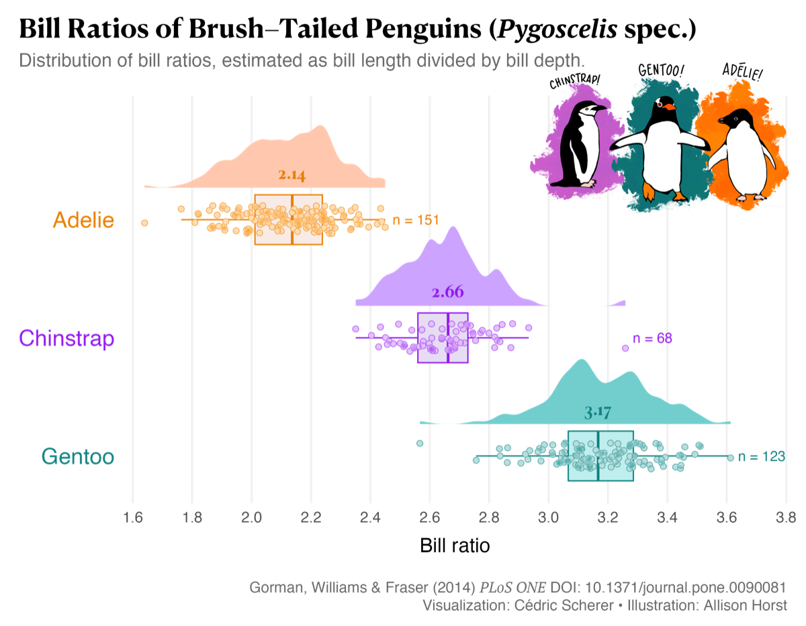

# Raincloud plots {#sec-raincloud-plots}

```{r}
#| label: setup
#| message: false
#| warning: false
#| include: false
library(tidyverse)
library(scales)
library(knitr)
library(kableExtra)
# fonts ----
library(extrafont)
library(sysfonts)
source("_common.R")
# use font
showtext::showtext_auto()
# set theme
ggplot2::theme_set(fmggp2::theme_rzone(
    base_size = 15))
library(raincloudplots)
library(ggdist)
```

::: {.callout-tip collapse="true" appearance="simple"}
## Theme: `theme_rzone()`

Graphs in this chapter use `fmggp2::theme_rzone()`, built from the Tiger R-Zone headset (1995): black plastic, a red frame and title, red LCD, purple logo, and pink marks, a pale blue visor text color, and an Arial Narrow title.
:::

:::: {.callout-note collapse="false" icon=false}

<br>

```{r}
#| label: full_code_display
#| eval: true
#| echo: false
#| warning: false
#| message: false
#| out-height: '60%'
#| out-width: '60%'
#| fig-align: right
library(raincloudplots)
library(ggdist)
library(ggplot2)
library(dplyr)
set.seed(1994)
rzone_games <- tibble(
  player_id = 1:240,
  game = rep(c("Racing", "Fighting", "Shooter"), each = 80)) |>
  mutate(game = factor(game,
           levels = c("Racing", "Fighting", "Shooter")),
         seconds = round(rlnorm(n(), sdlog = 0.5,
           meanlog = log(c(Racing = 15, Fighting = 30,
                           Shooter = 60)[as.character(game)])), 1))
labs_raincloud_2 <- ggplot2::labs(
    title = "Tiger R-Zone",
    caption = "Simulated data",
    x = "Seconds to clear the first level",
    y = "Game")
ggplot(rzone_games,
    aes(x = seconds, y = game)) +
  geom_boxplot(aes(fill = game),
    notch = TRUE,
    notchwidth = 0.9,
    width = .15,
    outlier.shape = NA) +
  ggdist::stat_halfeye(aes(fill = game),
    adjust = 0.6, # shape = adjust * density estimator
    .width = 0, # can use probabilities or 0
    point_colour = NA, # removes the point in center
    orientation = "horizontal", # like the box plot
    height = 0.5, # height of curve
    justification = -0.3) + # shift vertically above box
    geom_point(aes(fill = game),
        shape = 21,
        color = "#ffffff",
        alpha = 1/3, size = 1.8,
    position = position_jitter(
      seed = 321,
      width = 0,
      height = .07)) +
    theme(legend.position = "none") +
    labs_raincloud_2
```

```{r}
#| label: full_code_raincloudplots
#| eval: true
#| echo: false
#| warning: false
#| message: false
#| out-height: '60%'
#| out-width: '60%'
#| fig-align: right
set.seed(1993)
rzone_tries <- faux::rnorm_multi(n = 100,
    mu = c(log(40), log(20)), sd = 0.5, r = 0.7,
    varnames = c("log_first", "log_second")) |>
  as_tibble() |>
  mutate(player_id = 1:100,
         first_try = round(exp(log_first), 1),
         second_try = round(exp(log_second), 1)) |>
  select(player_id, first_try, second_try)
rzone_1x1 <- raincloudplots::data_1x1(
  array_1 = rzone_tries$first_try,
  array_2 = rzone_tries$second_try,
  jit_distance = 0.2, # distance between points
  jit_seed = 2736) # used in set.seed()
ggp2_raincloud <- raincloud_1x1_repmes(
    data_1x1 = rzone_1x1,
    colors = (c('#FF2E93', '#14D8C4')),
    fills = (c('#FF2E93', '#14D8C4')),
    line_color = "#F2F0FF",
    line_alpha = 0.3,
    size = 0.8,
    alpha = 3/4
)
ggp2_raincloud_x <- ggp2_raincloud +
    scale_x_continuous(
        breaks = c(1, 2),
        labels = c("First try", "Second try"),
        limits = c(0, 3))
ggp2_raincloud_x +
    labs(title = "Tiger R-Zone",
        caption = "Simulated data",
        subtitle = "100 players, two tries each",
         x = NULL, y = "Seconds to clear the first level")
```

::: {style="font-size: 1.10em; color: #02577A;"}
**Requirements:**
:::

::: {style="font-size: 1.05em; color: #282b2d;"}
**✅ a categorical variable**
:::

::: {style="font-size: 1.05em; color: #282b2d;"}
**✅ a numeric (continuous) variable**
:::

::::

## Description

Raincloud plots are a combination of a density graph, a box plot, and a beeswarm (or jitter) plot. They're used to compare distributions of quantitative/numerical variables across the levels of a categorical (or discrete) grouping variable.

We can use the [`raincloudplots` package](https://github.com/jorvlan/raincloudplots) to create raincloud plots, or they can be built using the [`ggdist` package](https://mjskay.github.io/ggdist/) and geoms from `ggplot2`.

## Set up

::: {style="font-size: 1.15em; color: #1e83c8;"}
**PACKAGES:**
:::

::: {style="font-size: 0.95rem;"}
Install packages.
:::

::: {style="font-size: 0.85em;"}
```{r}
#| label: pkg_code_raincloud
#| code-fold: show
#| eval: false
#| echo: true
#| warning: false
#| message: false
#| results: hide
remotes::install_github('jorvlan/raincloudplots')
remotes::install_github('mjskay/ggdist')
install.packages("faux")
library(raincloudplots)
library(ggdist)
library(faux) # for rnorm_multi()
library(ggplot2)
library(dplyr) # for tibble() and data manipulation
```
:::

::: {style="font-size: 1.15em; color: #1e83c8;"}
**DATA:**
:::

Tiger's [R-Zone](https://en.wikipedia.org/wiki/R-Zone) (1995) was a game console you wore on your head: a cartridge projected red LCD graphics onto a small visor in front of one eye. The games were simple, so most players cleared the first level much faster on their second try (if their eyes held out). We'll simulate how many seconds it took 100 players to clear the first level on their first and second tries.

`faux::rnorm_multi()` draws two correlated columns from a normal distribution: the log of the first try (centered on 40 seconds) and the log of the second try (centered on 20 seconds). The correlation (`r`) of 0.7 means players who are slow the first time tend to be slow the second time too. `exp()` turns the logs back into seconds. Setting the seed with `set.seed()` means you'll get the same 100 players every time you run the code below.

The `raincloudplots` package has a `data_1x1()` function we can use to build the dataset for a 1x1 repeated measure graph (`rzone_1x1`). This function takes two array arguments (`array_1` and `array_2`), which we create from the `first_try` and `second_try` columns. The `jit_distance` and `jit_seed` refer to the points in the plot.

::: {style="font-size: 0.85em;"}
```{r}
#| label: data_code_raincloud
#| code-fold: show
#| eval: true
#| echo: true
set.seed(1993) # same 100 players every time the code runs
rzone_tries <- faux::rnorm_multi(n = 100, # 100 different players
    mu = c(log(40), log(20)), # first try averages 40 seconds, second try 20 (on the log scale)
    sd = 0.5, # spread on the log scale
    r = 0.7, # players who are slow the first time are slow the second time
    varnames = c("log_first", "log_second")) |>
  as_tibble() |>
  mutate(
    player_id = 1:100, # one row per player
    first_try = round(exp(log_first), 1), # back to seconds
    second_try = round(exp(log_second), 1) # back to seconds
    ) |>
  select(player_id, first_try, second_try)
rzone_1x1 <- raincloudplots::data_1x1(
  array_1 = rzone_tries$first_try, # first group of points
  array_2 = rzone_tries$second_try, # second group of points
  jit_distance = 0.2, # distance between points
  jit_seed = 2736) # used in set.seed()
glimpse(rzone_1x1)
```
:::

## Distribution

A raincloud plot shows a whole distribution three ways at once (the cloud, the box, and the rain). The R-Zone data adds a twist: the two groups are the *same* 100 players measured twice, so each first try has a partner second try. Comparing the two clouds only tells part of the story; the pairs tell the rest. Below we'll move from the players, to a picture, to the formula.

::: {style="font-size: 1.10em; color: #1e83c8;"}
**COUNT IT:**
:::

Start with the first five players.

::: {style="font-size: 0.85em;"}
```{r}
#| label: count_values_raincloud
#| code-fold: show
#| eval: true
#| echo: true
head(rzone_tries, 5)
```
:::

Four of these five players cleared the level much faster on their second try, but player 3 took more than twice as long. The summary below compares the two tries for all 100 players. The median drops by about half, almost every player was faster the second time, and the correlation shows that slow first tries go with slow second tries.

::: {style="font-size: 0.85em;"}
```{r}
#| label: count_summary_raincloud
#| code-fold: show
#| eval: true
#| echo: true
rzone_tries |>
  summarise(median_first = median(first_try),
            median_second = median(second_try),
            share_faster = mean(second_try < first_try),
            correlation = cor(log(first_try), log(second_try)))
```
:::

::: {style="font-size: 1.10em; color: #1e83c8;"}
**DRAW IT:**
:::

The graph below plots each player's two tries against each other on log scales. The solid line is "no change" (second try = first try), and the dashed line is "twice as fast" (second try = half the first try). The points cluster around the dashed line, and they fall along a band rather than a blob because of the correlation.

::: {style="font-size: 0.85em;"}
```{r}
#| label: draw_raincloud
#| code-fold: show
#| eval: true
#| echo: true
guide_lines <- tibble(
  line = c("No change", "Two times as fast"),
  intercept = c(0, log10(0.5)))
ggplot(rzone_tries, aes(x = first_try, y = second_try)) +
  geom_abline(data = guide_lines,
    aes(slope = 1, intercept = intercept, color = line, linetype = line)) +
  geom_point(shape = 21, fill = "#FF2E93", color = "#ffffff",
    size = 2.2, alpha = 0.8) +
  scale_x_log10() +
  scale_y_log10() +
  scale_color_manual(values = c("#F2F0FF", "#14D8C4")) +
  scale_linetype_manual(values = c("solid", "dashed")) +
  labs(x = "First try (seconds, log10 scale)",
       y = "Second try (seconds, log10 scale)",
       color = NULL, linetype = NULL) +
  theme(legend.position = "top")
```
:::

::: {style="font-size: 1.10em; color: #1e83c8;"}
**NAME IT:**
:::

The two log times come from a [bivariate normal distribution](https://en.wikipedia.org/wiki/Multivariate_normal_distribution), which makes each try [log normal](https://en.wikipedia.org/wiki/Log-normal_distribution) on the seconds scale:

$$
\begin{pmatrix} \log(\text{first}) \\ \log(\text{second}) \end{pmatrix} \sim \text{Normal}\left(\begin{pmatrix} \log 40 \\ \log 20 \end{pmatrix}, \; \sigma = 0.5, \; \rho = 0.7\right)
$$

The difference between the two logs is the log of the speed up, $\log(\text{second} / \text{first})$. It's centered on $\log(20 / 40) = \log(0.5)$ (twice as fast), and its standard deviation is $\sigma\sqrt{2(1 - \rho)} = 0.5\sqrt{0.6} \approx 0.39$. The correlation shrinks that spread: if the two tries were independent ($\rho = 0$), the spread would be $0.5\sqrt{2} \approx 0.71$, and many more players would have been slower the second time. That's why paired data (and raincloud plots that connect the pairs) can show a difference that two separate clouds hide. Try changing `r` to `0` in `rnorm_multi()` and the band of points spreads into a cloud.


## Grammar (`raincloudplots`)

::: {style="font-size: 1.15em; color: #1e83c8;"}
**CODE:**
:::

Create labels with `labs()`

Use the `raincloudplots::raincloud_1x1_repmes()` to build the plot, assigning `rzone_1x1` to `data_1x1`

  - assign `colors` and `fills`

  - set the `line_color` and `line_alpha` (for the lines that connect each player's two tries)

  - set the size (of the points) and alpha (for opacity)

::: {style="font-size: 0.85em;"}
```{r}
#| label: code_graph_raincloud
#| code-fold: show
#| eval: false
#| echo: true
#| warning: false
#| message: false
#| out-height: '100%'
#| out-width: '100%'
ggp2_raincloud <- raincloudplots::raincloud_1x1_repmes(
    data_1x1 = rzone_1x1,
    colors = (c('#FF2E93', '#14D8C4')),
    fills = (c('#FF2E93', '#14D8C4')),
    line_color = "#F2F0FF",
    line_alpha = 0.3,
    size = 0.8,
    alpha = 3/4)
ggp2_raincloud_x <- ggp2_raincloud +
    ggplot2::scale_x_continuous(
        breaks = c(1, 2),
        labels = c("First try", "Second try"),
        limits = c(0, 3))
ggp2_raincloud_x +
    ggplot2::labs(
        title = "Tiger R-Zone",
        caption = "Simulated data",
        subtitle = "100 players, two tries each",
        x = NULL,
        y = "Seconds to clear the first level")
```
:::


::: {style="font-size: 1.15em; color: #1e83c8;"}
**GRAPH:**
:::

```{r}
#| label: create_graph_raincloud
#| eval: true
#| echo: false
#| warning: false
#| message: false
#| out-height: '100%'
#| out-width: '100%'
#| layout-nrow: 1
ggp2_raincloud <- raincloudplots::raincloud_1x1_repmes(
    data_1x1 = rzone_1x1,
    colors = (c('#FF2E93', '#14D8C4')),
    fills = (c('#FF2E93', '#14D8C4')),
    line_color = "#F2F0FF",
    line_alpha = 0.3,
    size = 0.8,
    alpha = 3/4)
ggp2_raincloud_x <- ggp2_raincloud +
    ggplot2::scale_x_continuous(
        breaks = c(1, 2),
        labels = c("First try", "Second try"),
        limits = c(0, 3))
ggp2_raincloud_x +
    ggplot2::labs(
        title = "Tiger R-Zone",
        caption = "Simulated data",
        subtitle = "100 players, two tries each",
         x = NULL,
        y = "Seconds to clear the first level")
```

## More info

::: {style="font-size: 1.15em; color: #1e83c8;"}
**DATA:**
:::

We'll simulate first tries for 80 players on each of three kinds of R-Zone games (`rzone_games`). Each kind of game gets its own typical time (15, 30, or 60 seconds), and `rlnorm()` draws each player's time.

::: {style="font-size: 0.85em;"}
```{r}
#| label: data_code_ggdist
#| eval: true
#| echo: true
set.seed(1994) # same 240 players every time the code runs
rzone_games <- tibble(
  player_id = 1:240, # 240 different players, one row each
  game = rep(c("Racing", "Fighting", "Shooter"), each = 80) # 80 players per game
  ) |>
  mutate(
    game = factor(game,
      levels = c("Racing", "Fighting", "Shooter")), # shortest to longest
    seconds = round(
      rlnorm(n(), sdlog = 0.5, # seconds to finish the first level (skewed right)
        meanlog = log(c(Racing = 15, Fighting = 30, # typical seconds
                        Shooter = 60)[as.character(game)])), # (looked up for each game)
      1 # one decimal place
      )
    )
glimpse(rzone_games)
```
:::

### Box-plot

  -   Create labels with `labs()`

  -   Initialize the graph with `ggplot()` and provide `data`

  -   For the first layer, we create a box plot with `geom_boxplot()`, but include notches and remove the outliers (the points we add below still show them).

::: {style="font-size: 0.85em;"}
```{r}
#| label: create_graph_raincloud2_box
#| eval: true
#| echo: true
#| warning: false
#| message: false
#| out-height: '100%'
#| out-width: '100%'
#| layout-nrow: 1
labs_raincloud_2 <- ggplot2::labs(
    title = "Tiger R-Zone",
    caption = "Simulated data",
    x = "Seconds to clear the first level",
    y = "Game")
ggp2_box <- ggplot(rzone_games,
    aes(x = seconds, y = game)) +
  geom_boxplot(aes(fill = game),
    notch = TRUE,
    notchwidth = 0.9,
    width = 0.15,
    outlier.shape = NA,
    show.legend = FALSE)
ggp2_box +
    labs_raincloud_2
```
:::

### Density

We then add a horizontal density curve with `ggdist::stat_halfeye()`, mapping `game` to `fill`, and adjusting the size and shape of the density curve and shifting it slightly above the box plot.

::: {style="font-size: 0.85em;"}
```{r}
#| label: create_graph_raincloud2_halfeye
#| eval: true
#| echo: true
#| warning: false
#| message: false
#| out-height: '100%'
#| out-width: '100%'
#| layout-nrow: 1
ggp2_stat_halfeye <- ggp2_box +
  ggdist::stat_halfeye(aes(fill = game),
    adjust = 0.6, # shape = adjust * density estimator
    .width = 0, # can use probabilities or 0
    point_colour = NA, # removes the point in center
    orientation = "horizontal", # like the box plot
    height = 0.5, # height of curve
    justification = -0.3, # shift vertically above box
    show.legend = FALSE # don't need this
)
ggp2_stat_halfeye +
    labs_raincloud_2
```
:::

### Points

The final layer is a `geom_point()`, mapping `fill` to `game` and setting `position` to `position_jitter()`. Additional adjustments to the points include:

- Using `shape = 21`, we can `color` the outside of the point (white makes it appear to glow).

- Manually set the `height`, which refers to the vertical area for the points, and set `width = 0` so each point stays at its true number of seconds

::: {style="font-size: 0.85em;"}
```{r}
#| label: create_graph_raincloud2_jitter
#| eval: true
#| echo: true
#| warning: false
#| message: false
#| out-height: '100%'
#| out-width: '100%'
#| layout-nrow: 1
ggp2_jitter <- ggp2_stat_halfeye +
    geom_point(aes(fill = game),
        position = position_jitter(
          seed = 321,
          width = 0,
          height = .07),
            shape = 21,
            color = "#ffffff",
            alpha = 1/3,
            size = 1.8,
            show.legend = FALSE)
ggp2_jitter +
    labs_raincloud_2
```
:::

## More examples & resources

### Point shape

Cédric Scherer covered raincloud plots in [this great write-up](https://www.cedricscherer.com/2021/06/06/visualizing-distributions-with-raincloud-plots-and-how-to-create-them-with-ggplot2/) for [#TidyTuesday](https://github.com/rfordatascience/tidytuesday).

Cédric also covers some alternative methods for plotting the points (I particularly like using bands instead of points when displaying the rainclouds vertically).

We can switch to this layout by applying `ggplot2::coord_flip()` to the `ggp2_stat_halfeye` layer, then adding `geom_point()` with `shape` set to `95`

::: {style="font-size: 0.85em;"}
```{r}
#| label: create_graph_raincloud2_point_lines
#| eval: true
#| echo: true
#| warning: false
#| message: false
#| out-height: '100%'
#| out-width: '100%'
#| layout-nrow: 1
ggp2_stat_halfeye +
    ggplot2::coord_flip() +
ggplot2::geom_point(
    shape = 95,
    size = 8,
    alpha = 0.2) +
    theme(legend.position = "none") +
    labs_raincloud_2
```
:::

### #TidyTuesday example

The code to re-create the #TidyTuesday graph is contained in this [gist.](https://gist.github.com/z3tt/8b2a06d05e8fae308abbf027ce357f01)

{fig-align="center" width="85%"}

### More resources

::: {style="font-size: 1.15em; color: #1e83c8;"}
**MORE RESOURCES**
:::

::: {style="font-size: 0.95rem;"}

1. Raincloud plots: a multi-platform tool for robust data visualization. [1](https://www.ncbi.nlm.nih.gov/pmc/articles/PMC6480976/)

2. Shape and point sizes in R. [2](https://r-graphics.org/recipe-scatter-shapes)

3. RainCloudPlots package on GitHub. [3](https://github.com/RainCloudPlots/RainCloudPlots)

:::
